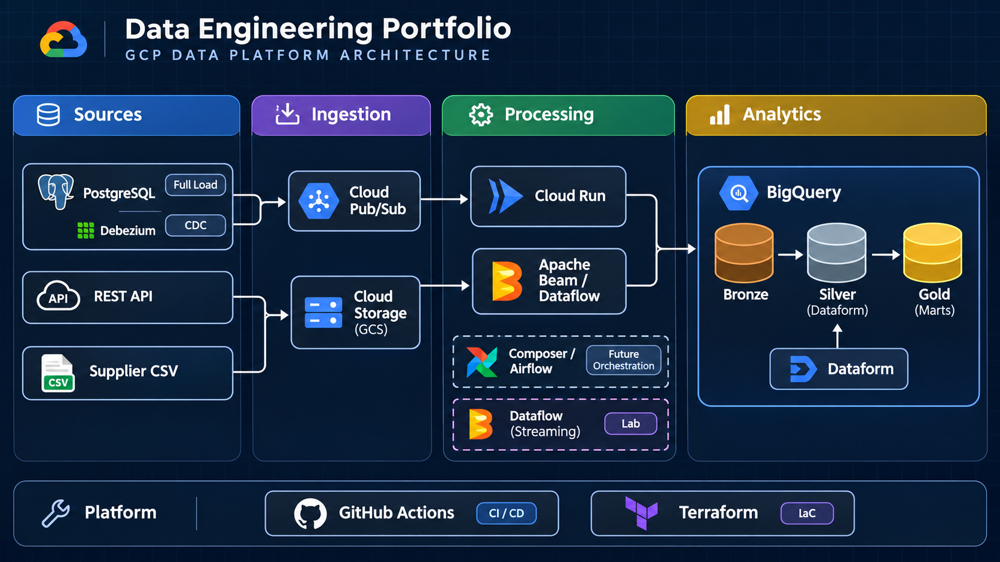

# Plataforma de Engenharia de Dados GCP

Projeto de portfólio que implementa uma plataforma de dados para um domínio de
e-commerce, com ingestão de múltiplas fontes, arquitetura Medallion,
processamento batch, CDC, modelagem analítica, qualidade, infraestrutura como
código e CI/CD.

## Arquitetura



O diagrama também possui uma versão vetorial/editável em
[`docs/architecture.svg`](docs/architecture.svg).

### Fluxos principais

| Fonte | Ingestão | Bronze | Modelagem |
| --- | --- | --- | --- |
| PostgreSQL full | Cloud Run Job com leitura server-side | GCS Parquet e BigQuery | Dataform Silver/Gold |
| PostgreSQL CDC | Debezium Server, Pub/Sub e consumidor Cloud Run | BigQuery CDC append-only | Dataform aplica o estado atual |
| API DummyJSON | Cloud Run Job -> GCS Raw | Dataflow Batch -> BigQuery | Dataform Silver e reconciliação Gold |
| CSV de fornecedor | GCS -> Dataflow Batch | BigQuery com rejeitos em DLQ | Dataform Silver e reconciliação Gold |

O catálogo final reconcilia produtos do PostgreSQL, da API e do fornecedor no
mart `ecommerce_gold.mart_catalogo_reconciliado`.

## Tecnologias

- **GCP:** Cloud Storage, BigQuery, Pub/Sub, Cloud Run Jobs, Dataflow e
  Dataform;
- **Orquestração preparada:** Cloud Composer/Airflow, com DAGs versionadas e
  envio manual controlado;
- **CDC:** Debezium Server com PostgreSQL logical replication;
- **Código:** Python, Apache Beam, SQLX/JavaScript do Dataform e Terraform;
- **Entrega:** GitHub Actions, Artifact Registry, Workload Identity Federation
  e imagens fixadas por digest;
- **Qualidade:** testes unitários, assertions Dataform, DLQ, métricas Beam,
  manifests, contratos de dados e reconciliação por contagem/chave.

## Camadas do lakehouse

1. **Raw:** arquivos originais imutáveis no GCS, com `run_id`, `batch_id` e
   manifesto quando aplicável;
2. **Bronze:** cópia técnica e append-only, preservando a origem e metadados
   de linhagem;
3. **Silver:** deduplicação, aplicação do estado CDC, padronização e regras de
   qualidade;
4. **Gold:** dimensões, fatos, marts e reconciliação entre fontes.

## Confiabilidade

- objetos Raw usam precondição de não sobrescrita;
- reexecuções da API no mesmo objeto retornam `already_exists`;
- full PostgreSQL usa manifesto, checkpoint, staging e transação BigQuery;
- Silver seleciona a versão mais recente por chave de negócio e timestamp;
- Pub/Sub usa retry/dead-letter e o consumidor preserva o evento original;
- Dataflow separa registros inválidos em DLQ e expõe métricas Beam;
- Dataform executa assertions de chave, metadados, granularidade e
  reconciliação.

O Bronze externo é append-only. Em uma futura operação produtiva com retries
após falha parcial do Dataflow Batch, deve ser adicionado um registro de lotes
ou uma etapa de staging para impedir duplicidade física no Bronze; o resultado
da Silver já é semanticamente idempotente.

## CI/CD

- [CI Python](.github/workflows/ci.yml): testes e sintaxe Python/DAG;
- [CI Dataform](.github/workflows/ci-dataform.yml): compilação do grafo;
- [Deploy Cloud Run](.github/workflows/deploy-cloud-run-images.yml): imagens
  de ingestão/materialização quando os caminhos correspondentes mudam;
- [Deploy Composer](.github/workflows/deploy-composer-dags.yml): manual,
  porque o ambiente Composer está desligado no laboratório;
- [Templates Dataflow](.github/workflows/deploy-dataflow-templates.yml):
  manual e sem iniciar job Streaming.

## Controle de custo

O repositório deixa preparados os componentes, mas não mantém processamento
contínuo:

- Composer não fica provisionado;
- Dataflow Batch só executa sob demanda;
- Dataflow Streaming é apenas um template isolado para laboratório;
- Cloud Run Jobs executam somente quando chamados;
- templates, imagens e dados persistidos continuam sujeitos ao custo normal
  de armazenamento.

## Como validar localmente

```powershell
& .\.venv\Scripts\python.exe -m pytest -q
& .\.venv\Scripts\python.exe -m compileall -q src orchestration/composer/dags tests
```

Para criar ou ajustar recursos GCP, use os módulos em
`infra/terraform/`. Os arquivos `terraform.tfvars`, `.env` e credenciais não
devem ser commitados.

## Organização do repositório

| Diretório | Conteúdo |
| --- | --- |
| `src/ingestion/` | extratores PostgreSQL, API, contratos Raw e consumidor CDC |
| `src/dataflow/` | pipelines Beam Batch e Streaming isolado |
| `definitions/` e `includes/` | modelos e assertions Dataform |
| `orchestration/composer/dags/` | DAGs futuras e planos determinísticos |
| `infra/terraform/` | buckets, IAM, Cloud Run, Pub/Sub, Dataform e CI/CD |
| `.github/workflows/` | validação e publicação controlada |
| `docs/` | arquitetura, operação, Dataform, CDC e observabilidade |

## Documentação

- [Arquitetura detalhada](docs/ARCHITECTURE.md);
- [Runbook operacional](docs/OPERATIONS_RUNBOOK.md);
- [Observabilidade](docs/OBSERVABILITY.md);
- [Dataform](docs/DATAFORM.md);
- [Coordenação Full + CDC](docs/CDC_FULL_COORDINATION.md);
- [Dataflow](infra/dataflow/README.md);
- [DAGs Composer](orchestration/composer/README.md).

